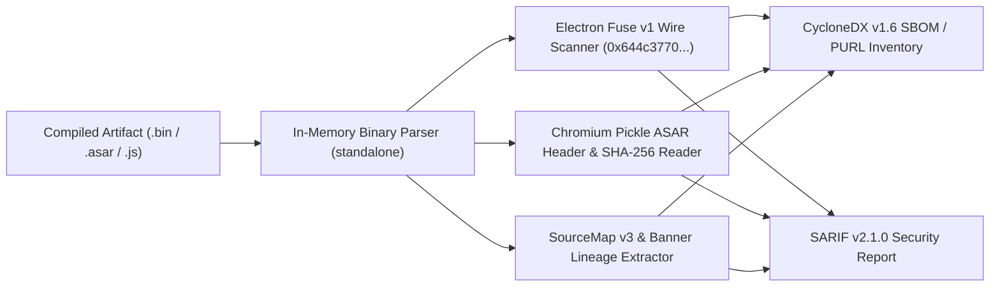

<!-- SPDX-FileCopyrightText: 2026 Mark (malfunctionAI) / KoodiKiht -->
<!-- SPDX-License-Identifier: MIT -->

# `bundle-provenance`

**Post-build binary & client bundle supply-chain auditor (`Electron Fuses`, `ASAR Chromium Pickle`, `SourceMap v3`, `Package-URL / PurlDB` & `CycloneDX v1.6`).**

[](LICENSE)
[](https://api.reuse.software/info/github.com/koodikiht/bundle-provenance)


---

## Problem Statement

Conventional SBOM and SCA tools (`Syft`, `Trivy`, `npm audit`) inspect pre-build manifest files (`package.json`, lockfiles). However, end users and enterprise environments execute **compiled post-build client artifacts**:
- Packaged **Electron binaries** (`ELF`, `Mach-O`, `PE`) and **`app.asar`** archives (`Chromium Pickle` binary headers).
- Minified **web bundles** (`.js` + `.map`) where `node_modules` hierarchy is flattened.
- Browser extensions (`.crx`) and mobile bytecode bundles.

Between source repository and release artifact, build pipelines frequently introduce **phantom (undeclared) dependencies**, leave dangerous runtime **Electron Fuses** enabled (`RunAsNode`, `EnableNodeCliInspectArguments`), omit `ASAR` block integrity hashes, or embed undocumented external telemetry endpoints.

`bundle-provenance` inspects compiled client artifacts **strictly in memory** (without disk extraction or third-party runtime dependencies) to recover accurate **`Package-URL` (`purl`)** coordinates, verify binary hardening flags, and emit standard **`CycloneDX v1.6`** and **`SARIF v2.1.0`** reports.

---

## Architecture (`v0.1.0`)



### Capabilities in `v0.1.0`
1. **Byte-Level Electron Fuse v1 Auditor (`src/fuses.ts`)**:
   - Scans raw executables for the 32-byte wire sentinel (`dL7pKGdnNz796PbbjQWNKmHXBZaB9tsX`), decodes the 8-byte fuse vector (`RunAsNode`, `EnableCookieEncryption`, `EnableNodeOptionsEnvironmentVariable`, `EnableNodeCliInspectArguments`, `EnableEmbeddedAsarIntegrityValidation`, `OnlyLoadAppFromAsar`, `LoadBrowserProcessSpecificV8Snapshot`, `GrantFileProtocolExtraPrivileges`), reports exact hex offsets, and flags `FUSE-001..FUSE-006` risks.
2. **In-Memory `Chromium Pickle` ASAR Inspector (`src/asar.ts`)**:
   - Parses the 16-byte little-endian `UInt32` pickle header without extracting untrusted files to disk (preventing Zip-Slip / path traversal `ASAR-001`).
   - Recovers all nested `node_modules/**/package.json` slices directly from archive byte offsets, computes `SHA-256` manifest digests, constructs `pkg:npm/...` PURLs, verifies per-file 4MB block integrity presence (`ASAR-002`), and inventories native binary addons (`.node`, `.dll`, `.dylib`, `.so` — `ASAR-003`).
3. **Web Bundle Lineage & Phantom Dependency Detector (`src/sourcemap.ts`)**:
   - Extracts upstream package versions from `SourceMap v3` (`sources` array, including `.pnpm` virtual store paths) and bundler `@license` banners.
   - Cross-checks embedded packages against a declared `package.json` manifest (`--manifest`) to detect **phantom (undeclared) packages** (`BUNDLE-001`) and extracts hardcoded external `https://` and `wss://` endpoints.
4. **Standard Exporters (`src/reporters.ts`)**:
   - `--format text`: human-readable terminal summary.
   - `--format json`: structured PURL and finding telemetry compatible with **AboutCode `PurlDB`** ingestion pipelines.
   - `--format cyclonedx`: compliant **CycloneDX v1.6 JSON** SBOM for **EU Cyber Resilience Act (CRA)** Module A technical files.
   - `--format sarif`: **SARIF v2.1.0** for GitHub Code Scanning / CI gating (`--fail-on-high`).

---

## Quick Start & Verification

Requires `bun >= 1.1` (or `node >= 22.6` with `--experimental-strip-types`). No external npm packages required at runtime.

```bash
# Run offline verification test suite (synthesizes binary Fuse wires, ASAR pickles, and SourceMaps)
bun test

# Scan an Electron executable for insecure Fuse bits
bun run src/cli.ts scan /path/to/ElectronApp --fail-on-high

# Scan a packed app.asar and emit a CycloneDX v1.6 SBOM
bun run src/cli.ts scan /path/to/app.asar --format cyclonedx > sbom.cdx.json

# Verify a production web bundle against its declared package.json to catch phantom dependencies
bun run src/cli.ts scan dist/bundle.min.js --map dist/bundle.min.js.map --manifest package.json --format sarif
```

---

## Provenance & Generative AI Policy

Maintained by Mark ([`@malfunctionAI`](https://github.com/malfunctionAI)) at [KoodiKiht](https://koodikiht.dev) (Tallinn, Estonia).

In accordance with **NLnet Foundation Generative AI Policy v2.0 (October 2026)** and EU copyright hygiene:
- All binary parsers, offset calculations, test suites, and documentation in this repository are **human-authored**.
- Generative AI / LLM code generation is strictly prohibited in project contributions (see [`CONTRIBUTING.md`](CONTRIBUTING.md)).

## License

MIT © 2026 Mark (`malfunctionAI`) / KoodiKiht. Compliant with [FSFE REUSE 3.2](https://reuse.software/).
